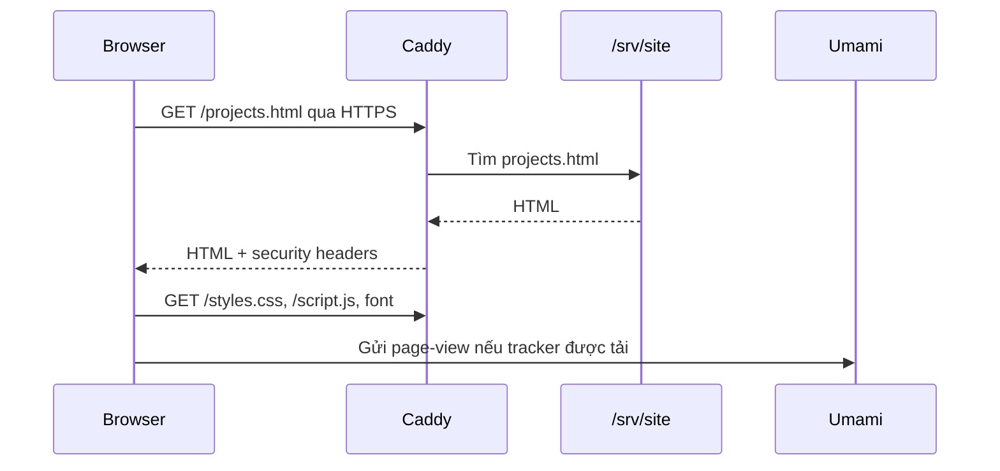
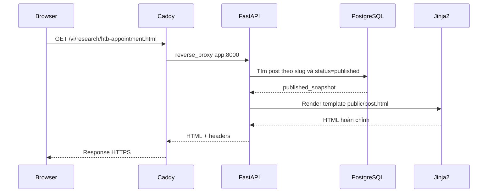
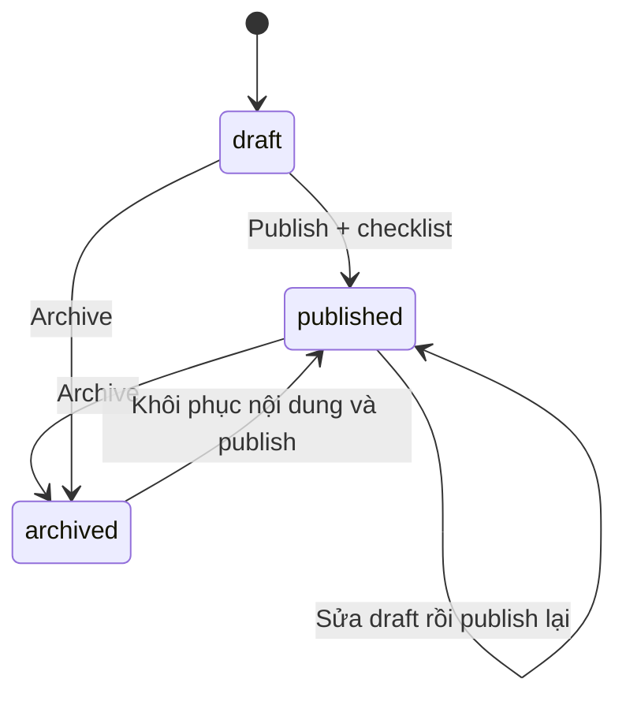

# Nguyên lý hoạt động của Cybersecurity Portfolio

Tài liệu này giải thích hệ thống từ lúc trình duyệt gửi request đến khi Caddy,
FastAPI, PostgreSQL và Umami xử lý xong. Mục tiêu là giúp mình có thể tự vận
hành, chẩn đoán lỗi và tiếp tục phát triển website mà không phải xem toàn bộ mã
nguồn trước.

## 1. Mô hình tổng quát

Website dùng kiến trúc **hybrid**:

- Các trang hồ sơ ít thay đổi như Home, About, Projects, Certifications và CV
  là file tĩnh.
- Research, Write-up, admin CMS, API, sitemap và RSS là nội dung động do
  FastAPI tạo.
- PostgreSQL lưu nội dung CMS, phiên bản bài viết, tài khoản và phiên đăng nhập.
- Caddy là cửa vào duy nhất từ Internet: cấp HTTPS, phục vụ file tĩnh và chuyển
  request động vào đúng container.
- Umami chạy riêng để thu thập analytics không dùng cookie.

```mermaid
flowchart LR
    B[Trình duyệt] -->|HTTPS 443| L[Lightsail firewall]
    L --> C[Caddy]
    C -->|Trang tĩnh| S[/srv/site]
    C -->|Ảnh upload| U[(Docker volume uploads)]
    C -->|Admin, API, Research| F[FastAPI + Uvicorn]
    C -->|analytics.truongbao.id.vn| M[Umami]
    F -->|SQLAlchemy + psycopg| P[(PostgreSQL)]
    M -->|Database riêng umami| P
    F -->|Đọc và ghi ảnh| U
    F -. Import khi được cấu hình .-> N[Notion API]
    P -. Backup tùy chọn .-> R[Restic / S3]
    U -. Backup tùy chọn .-> R
```

Điểm quan trọng là chỉ Caddy mở cổng ra Internet. FastAPI `8000`, PostgreSQL
`5432` và Umami `3000` chỉ trao đổi bên trong Docker network.

## 2. Vai trò của từng container

### `caddy`

Caddy giống như lễ tân của hệ thống. Mọi request đến domain đều đi qua Caddy
trước. Nó thực hiện bốn việc:

1. Nhận request HTTP/HTTPS trên cổng 80 và 443.
2. Tự xin và gia hạn chứng chỉ TLS từ Let's Encrypt.
3. Chọn nơi xử lý dựa trên hostname và đường dẫn.
4. Gắn các security header chung và nén response bằng gzip hoặc zstd.

### `app`

Đây là ứng dụng FastAPI chạy qua Uvicorn. Nó xử lý:

- Trang Research và từng bài viết.
- Public API `/api/v1/posts`.
- Login password + TOTP và toàn bộ CMS.
- Markdown preview, upload ảnh, revision, publish và archive.
- Sitemap, RSS, robots và health check.

Khi container khởi động, command trong Dockerfile chạy `alembic upgrade head`
trước, sau đó mới bật Uvicorn. Nhờ vậy database schema được cập nhật trước khi
ứng dụng nhận traffic.

### `postgres`

Một PostgreSQL container chứa ba database logic:

- Database bootstrap `postgres`.
- Database `portfolio`, do user `portfolio` sở hữu.
- Database `umami`, do user `umami` sở hữu.

FastAPI và Umami dùng user/database khác nhau, vì vậy lỗi hoặc credential của
một ứng dụng không mặc nhiên cấp quyền vào database còn lại.

### `umami`

Umami nhận sự kiện xem trang từ `script.js` trên
`analytics.truongbao.id.vn`. Dashboard analytics không nằm trong CMS và dùng
database `umami` riêng.

### `backup`

Container backup thuộc profile `maintenance`, nên không chạy cùng stack thông
thường. Khi được gọi, nó dump cả database `portfolio` và `umami`, thêm volume
upload rồi gửi snapshot đã mã hóa qua Restic đến S3-compatible storage.

## 3. Cách Caddy quyết định request đi đâu

Cấu hình chính nằm trong `Caddyfile`.

### Request file upload

Đường dẫn `/assets/uploads/*` được map trực tiếp vào volume `/srv/uploads`.
Caddy bỏ phần prefix bằng `handle_path`, đọc file và trả về với cache một năm.
Tên file upload là ngẫu nhiên và nội dung không đổi, nên cache `immutable` phù
hợp.

### Request động

Các đường dẫn sau được chuyển đến `app:8000`:

- `/admin*`
- `/api*`
- `/health/*`
- `/research.html`, `/research/*`
- `/vi/research.html`, `/vi/research/*`
- `/sitemap.xml`, RSS và `robots.txt`

Tên `app` được Docker DNS tự phân giải thành IP nội bộ của container FastAPI.
Không cần và không nên public cổng 8000.

### Request tĩnh

Nếu request không khớp route động hoặc upload, Caddy tìm file trong
`/srv/site`. Thư mục này được copy từ `dist/` khi build `Dockerfile.caddy`.

### Analytics subdomain

Request tới `analytics.truongbao.id.vn` được reverse proxy sang `umami:3000`.
Caddy thêm `X-Robots-Tag: noindex, nofollow` để dashboard không bị index.

### `www`

`www.truongbao.id.vn` trả redirect vĩnh viễn về `truongbao.id.vn`, giúp chỉ có
một canonical host.

## 4. Luồng khi người xem mở một trang tĩnh

Ví dụ: `https://truongbao.id.vn/projects.html`.



FastAPI và PostgreSQL không tham gia request này. Đây là lý do trang hồ sơ vẫn
tải nhanh và còn hoạt động ngay cả khi CMS tạm thời gặp lỗi.

Các file tĩnh được tạo bởi `tools/build_site.py`:

1. Đọc danh sách trang từ `content/pages.json`.
2. Đọc phần thân HTML trong `content/`.
3. Tạo bản tiếng Anh và bản tiếng Việt.
4. Điều chỉnh link tương đối, navigation, `hreflang`, metadata và analytics.
5. Ghi kết quả vào cây file rồi đóng gói vào `dist/`.

Thay đổi trang tĩnh cần build lại site và image Caddy. Thay đổi bài CMS không
cần build lại Caddy.

## 5. Luồng khi người xem mở Research

Ví dụ: `https://truongbao.id.vn/vi/research/htb-appointment.html`.



Public page đọc `published_snapshot`, không đọc trực tiếp nội dung draft đang
được sửa. Cơ chế này bảo đảm việc autosave trong admin không vô tình làm thay
đổi bài mà người xem đang đọc.

Danh sách Research lấy tất cả snapshot đã publish, sau đó lọc theo:

- Từ khóa.
- Tag.
- `research` hoặc `writeup`.
- Platform.
- Difficulty.

API dùng cùng nguồn dữ liệu nên website và `/api/v1/posts` không bị lệch nội
dung.

## 6. Vòng đời của một bài viết

### Bước 1: nhận dữ liệu

Editor gửi JSON đến admin API. Pydantic kiểm tra độ dài, kiểu dữ liệu, slug và
giá trị enum. Slug chỉ chấp nhận chữ thường ASCII, số và dấu gạch ngang.

### Bước 2: render Markdown an toàn

`render_markdown()` thực hiện:

1. MarkdownIt parse Markdown với raw HTML bị tắt.
2. Tạo ID ổn định cho heading và mục lục.
3. Nhận diện ảnh có caption dạng `Hình 1:` hoặc `Figure 1:`.
4. Gắn lazy loading cho ảnh.
5. Gắn `noopener` và `noreferrer` cho link ngoài.
6. Dùng `nh3` sanitize HTML theo allowlist tag, attribute và URL scheme.
7. Tính thời gian đọc theo khoảng 220 từ/phút.

Database giữ cả Markdown gốc và HTML đã sanitize. Public page chỉ render HTML
đã xử lý.

### Bước 3: lưu draft

`apply_input()` cập nhật bài, tag, HTML, mục lục, thời gian đọc và SHA-256 của
nội dung. Mỗi lần lưu tạo một `post_revision` mới. Editor còn autosave sau 30
giây khi có thay đổi.

### Bước 4: publish



Khi publish:

1. Write-up phải hoàn thành đủ checklist công khai, redaction và nguồn/retest.
2. Bài phải có ít nhất một tag.
3. Hệ thống tạo Open Graph image 1200 × 630.
4. Snapshot mới được ghi vào `published_snapshot`.
5. `published_content_hash` được cập nhật.
6. Một revision có reason `publish` được tạo.

Nếu tiếp tục sửa bài đã publish, `content_hash` khác
`published_content_hash`, CMS hiển thị “có bản nháp mới”. Người đọc vẫn thấy
snapshot cũ cho đến lần publish tiếp theo.

### Bước 5: archive hoặc restore

Archive đổi status và gỡ bài khỏi public list, API, sitemap và RSS nhưng không
xóa dữ liệu. Restore lấy một revision cũ đưa vào editor; muốn public phiên bản
đó vẫn phải publish lại.

## 7. Dữ liệu được lưu ở đâu

| Bảng | Mục đích |
|---|---|
| `posts` | Metadata, Markdown, HTML cache, status và published snapshot |
| `post_revisions` | Snapshot của mỗi lần save, restore, publish hoặc archive |
| `tags` | Danh mục tag chuẩn hóa |
| `post_tags` | Quan hệ nhiều-nhiều giữa bài và tag |
| `media` | Metadata ảnh: URL, hash, kích thước, MIME và alt text |
| `admin_users` | Một tài khoản admin, password hash, TOTP mã hóa |
| `admin_sessions` | Phiên đăng nhập với token đã hash và thời hạn |
| `login_attempts` | Thử đăng nhập sai để thực hiện rate limit |

Dữ liệu PostgreSQL nằm trong volume `postgres-data`. Xóa/recreate container
không xóa volume. Chỉ thao tác xóa volume mới làm mất database.

Ảnh upload nằm trong volume `uploads`; cả FastAPI và Caddy cùng mount volume
này với quyền phù hợp.

## 8. Cơ chế đăng nhập admin

Quá trình đăng nhập có hai bước.

### Password

1. GET `/admin/login` tạo một login CSRF token ngẫu nhiên.
2. Token được đặt trong cookie `HttpOnly` và hidden field.
3. POST login phải gửi hai giá trị trùng nhau.
4. Password được so sánh với Argon2id hash.
5. Lần thử sai được lưu theo HMAC của username và IP, không lưu IP thô.

Sau năm lần sai trong 15 phút, tài khoản hoặc nguồn IP tương ứng bị giới hạn.

### TOTP

Nếu password đúng, server tạo session chưa hoàn tất xác thực và chuyển đến
`/admin/totp`. TOTP secret trong database được mã hóa bằng Fernet. Mã sáu số có
window ±1 chu kỳ để chấp nhận sai lệch thời gian nhỏ. Recovery code được lưu
dạng Argon2 hash và bị xóa sau một lần dùng.

### Session và CSRF

- Trình duyệt giữ raw session token trong cookie.
- Database chỉ giữ HMAC hash của token.
- Cookie production có `Secure`, `HttpOnly`, `SameSite=Strict`.
- Session hết hạn sau thời gian idle hoặc thời hạn tuyệt đối.
- Mọi API thay đổi dữ liệu phải có `X-CSRF-Token` tính từ session hiện tại.
- Logout xóa session trong database và cookie trình duyệt.

Nếu database bị đọc trái phép, attacker không lấy được raw session token từ
bảng `admin_sessions` để đăng nhập trực tiếp.

## 9. Pipeline upload ảnh

Ảnh đi qua chuỗi kiểm tra sau:

1. Giới hạn request ở 8 MB.
2. Pillow mở và verify nội dung thật, không tin extension.
3. Chỉ chấp nhận JPEG, PNG hoặc WebP.
4. Chặn decompression bomb lớn hơn giới hạn pixel.
5. Resize tối đa 2400 × 2400.
6. Re-encode thành WebP, làm mất EXIF và metadata cũ.
7. Tạo tên UUID ngẫu nhiên và kiểm tra path vẫn nằm trong upload directory.
8. Ghi SHA-256, kích thước và alt text vào bảng `media`.

Caddy phục vụ ảnh từ volume với cache dài. Open Graph image được tạo riêng khi
publish và lưu dưới `/assets/uploads/og/<slug>.png`.

## 10. Import Notion

Import Notion là một luồng có kiểm soát, không phải URL fetch tùy ý:

1. Chỉ chấp nhận hostname Notion hợp lệ và trích page UUID.
2. Gọi `api.notion.com` bằng integration token.
3. Đọc block theo pagination và đệ quy.
4. Chuyển heading, paragraph, list, code, quote, callout, table và image sang
   Markdown.
5. Chỉ tải file từ hostname allowlist, bắt buộc HTTPS và địa chỉ IP công khai
   để giảm SSRF.
6. Ảnh Notion được đưa qua cùng pipeline upload an toàn.
7. Kết quả luôn là draft; block không hỗ trợ tạo warning.

Hiện production chưa cấu hình `NOTION_API_TOKEN`, nên chức năng này sẽ chủ động
báo lỗi thay vì thực hiện request không có credential.

## 11. Song ngữ hoạt động như thế nào

Trang tĩnh có hai file riêng:

- `/projects.html`
- `/vi/projects.html`

Build script dùng nguồn nội dung chung và bảng dịch để sinh hai cây URL, đồng
thời gắn `hreflang` để máy tìm kiếm hiểu quan hệ giữa hai bản.

Research dùng một record trong PostgreSQL:

- Nội dung chính và summary bằng tiếng Việt.
- Abstract và tiêu đề tùy chọn bằng tiếng Anh.
- Route `/research/...` dùng giao diện tiếng Anh.
- Route `/vi/research/...` dùng giao diện tiếng Việt.

Tên project, machine, công cụ và chứng chỉ được giữ bằng tiếng Anh theo quy ước
nội dung của portfolio.

## 12. Security header và ranh giới tin cậy

Caddy áp dụng:

- HSTS buộc HTTPS.
- `X-Content-Type-Options: nosniff`.
- `X-Frame-Options: DENY` và `frame-ancestors 'none'`.
- Referrer Policy.
- Permissions Policy tắt camera, microphone và geolocation.
- Content Security Policy chỉ cho tài nguyên từ chính website và Umami.

FastAPI cũng gắn security header cho response động và đặt `X-Robots-Tag` cho
admin. Đây là defense in depth: Caddy bảo vệ tại edge, FastAPI bảo vệ ngay cả
khi ứng dụng được đặt sau một reverse proxy khác.

Secret chỉ nằm trong `/srv/portfolio/.env`, không nằm trong image hoặc source
repository. Production từ chối khởi động nếu app secret quá yếu, thiếu khóa mã
hóa TOTP hoặc cookie secure bị tắt.

## 13. Analytics hoạt động như thế nào

Khi build trang tĩnh hoặc render trang động, nếu có đủ
`ANALYTICS_SCRIPT_URL` và `ANALYTICS_WEBSITE_ID`, HTML nhận thẻ:

```html
<script defer src="https://analytics.truongbao.id.vn/script.js"
        data-website-id="..."></script>
```

Trình duyệt tải tracker sau khi parse HTML rồi gửi page-view đến Umami. Crawler
chỉ dùng `curl` sẽ không chạy JavaScript và không tạo page-view như trình duyệt
thật. Dashboard analytics được đánh dấu `noindex` và không được gắn tracker của
chính nó vào CMS.

## 14. Health check phản ánh điều gì

`/health/live` chỉ xác nhận process FastAPI còn trả response. Nó không truy cập
database.

`/health/ready` chạy `SELECT 1` với SQLAlchemy. Endpoint này chỉ trả ready khi
cả ứng dụng và PostgreSQL giao tiếp được.

| Kết quả | Cách hiểu |
|---|---|
| Live OK, Ready OK | App và database hoạt động |
| Live OK, Ready lỗi | Process sống nhưng database có vấn đề |
| Cả hai lỗi, trang tĩnh vẫn mở | FastAPI lỗi; Caddy/file tĩnh còn hoạt động |
| Tất cả đều lỗi | Kiểm tra Caddy, Docker hoặc Lightsail network |

## 15. Dữ liệu tồn tại qua restart như thế nào

Container được xem là có thể thay thế. Khi `docker compose up --force-recreate`
tạo container mới:

- Code và dependency đến từ image mới.
- PostgreSQL đọc lại `postgres-data` cũ.
- Ảnh vẫn nằm trong `uploads`.
- Chứng chỉ vẫn nằm trong `caddy-data`.
- `.env` nằm trên host và được Compose đọc lại.

Vì vậy recreate `app` không làm mất bài. Ngược lại, source code mới sẽ không
tự cập nhật container cho đến khi build/pull image và recreate service.

## 16. Quy trình deploy một thay đổi

### Thay đổi FastAPI hoặc CMS

```bash
cd /srv/portfolio
docker compose build app
docker compose up -d --force-recreate app
curl --fail https://truongbao.id.vn/health/ready
```

### Thay đổi trang tĩnh hoặc Caddy

```bash
cd /srv/portfolio
set -a
. ./.env
set +a
python3 tools/build_site.py
python3 tools/check_site.py
python3 tools/package_site.py
docker compose build caddy
docker compose up -d --force-recreate caddy
```

### Thay đổi database schema

Tạo Alembic migration trong source. Khi image app mới khởi động, lệnh
`alembic upgrade head` chạy trước Uvicorn. Với migration quan trọng, cần backup
và thử restore trước khi deploy.

## 17. Các giới hạn hiện tại

- Một admin duy nhất, không có role hoặc contributor.
- Không có comment, newsletter, contact inbox hoặc lịch publish.
- Một VPS chạy toàn bộ dịch vụ; nếu VPS dừng thì phần động, analytics và
  database cùng dừng.
- Backup off-site đang tắt theo quyết định vận hành hiện tại.
- Import Notion chưa bật vì thiếu token.
- Static page cần rebuild khi đổi nội dung; bài CMS cập nhật ngay khi publish.

Kiến trúc này phù hợp lưu lượng portfolio nhỏ: đơn giản, chi phí dự đoán được,
dễ debug qua Docker Compose và vẫn tách rõ edge, application, database, upload
và analytics.

## 18. Bản đồ mã nguồn

| File/thư mục | Vai trò |
|---|---|
| `compose.yaml` | Khai báo service, network, volume và biến môi trường |
| `Caddyfile` | HTTPS, routing, static files và reverse proxy |
| `Dockerfile` | Build image FastAPI |
| `Dockerfile.caddy` | Đóng gói Caddy cùng `dist/` |
| `portfolio_cms/main.py` | Khởi tạo FastAPI và middleware |
| `portfolio_cms/routes/public.py` | Research, sitemap, RSS và health |
| `portfolio_cms/routes/admin.py` | Login, editor, upload, publish và Notion |
| `portfolio_cms/routes/api.py` | Public JSON API |
| `portfolio_cms/models.py` | SQLAlchemy data model |
| `portfolio_cms/security.py` | Password, TOTP, session, CSRF, rate limit |
| `portfolio_cms/content.py` | Draft, snapshot, publish và revision |
| `portfolio_cms/markdown.py` | Markdown render và HTML sanitizer |
| `portfolio_cms/media.py` | Upload và Open Graph image |
| `portfolio_cms/notion.py` | Notion importer và SSRF controls |
| `migrations/` | Alembic database migrations |
| `tools/build_site.py` | Sinh trang tĩnh Anh–Việt |
| `deploy/` | PostgreSQL init, backup, restore và systemd units |

Khi cần debug, hãy xác định request thuộc nhánh tĩnh, FastAPI hay Umami trước.
Việc này thường thu hẹp nguyên nhân nhanh hơn đọc toàn bộ log cùng lúc.
